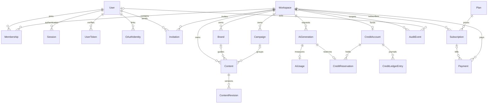
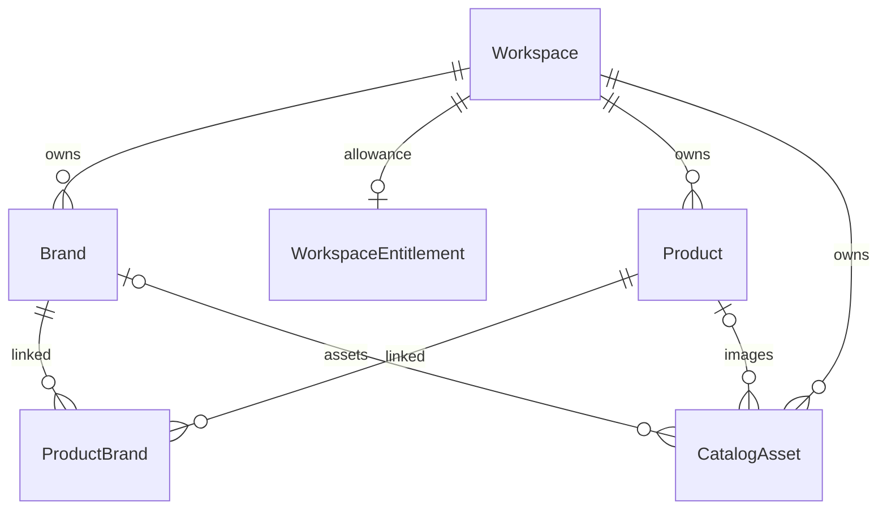
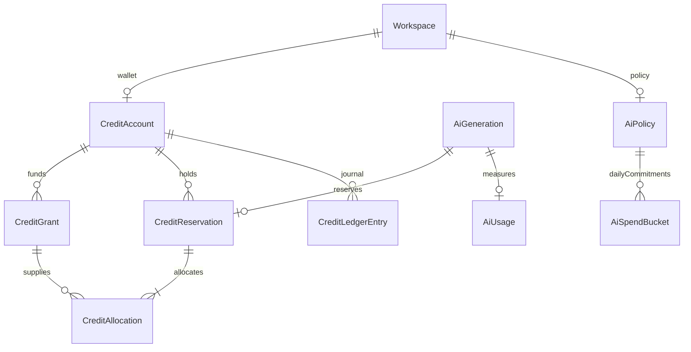
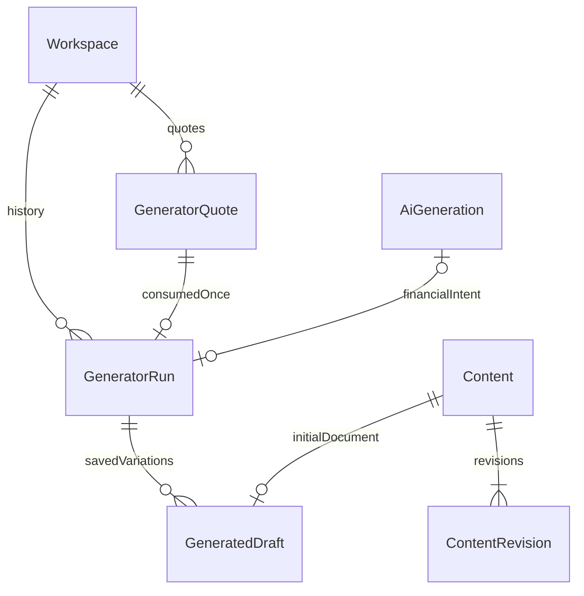

# Database foundation

Prisma schema is the executable model; initial SQL migration adds checks, partial indexes and append-only triggers that Prisma cannot express. UUIDs are generated by Prisma; all dates use timestamptz(3). Tenant entities use composite references `(workspaceId, id)`. Resource parent deletion is restricted; expired auth tokens/sessions can be pruned without deleting users or financial history.

`WebhookEvent` deduplicates provider notifications globally. `OutboxEvent` reliably bridges a committed transaction and queue dispatch. `SystemSetting` stores non-secret platform configuration. Administrative actions use User.systemRole and AuditEvent; there is no parallel administrator identity/password table.

Important invariants:

- Emails canonicalized to lowercase/trimmed in application, enforced by SQL CHECK and unique constraint. Language constrained to vi/en.
- Membership `(workspaceId,userId)` unique; at most one OWNER per workspace via partial index. At least one owner needs transaction policy (03).
- Invitation cannot grant OWNER and cannot be both accepted/revoked.
- Content revisions use positive monotonic application-managed versions; unique `(workspaceId,contentId,version)`.
- Campaign end >= start if both specified.
- Account `balance >= reserved >= 0`; nonzero signed ledger entries; positive reservations, nonnegative usage/cost.
- USAGE debits; grants/purchases/refunds credit; adjustments may have either sign. Financial records and audit cannot update/delete.
- One active/past-due subscription per workspace (partial unique index). Provider external IDs/events deduplicated.
- No plaintext auth or invitation tokens. Token hash columns receive cryptographically secure digests in 03.

Database runtime role separation (migrations owner vs constrained application user), backups, retention and disaster-recovery drills are deployment acceptance items in 15. Current local Compose uses one development database identity; it is not proof of production least privilege.

Schema presence does not implement any AI, content, billing or administration business flow.

Phase 03 completion adds migration 20261104000300_pagination_outbox_indexes for membership/user/workspace page keys, invitation page keys, active sessions and pending outbox dispatch. Email outbox payloads are authenticated ciphertext. Token/invitation records and events commit together; worker publishes using event UUID as the queue job ID before marking publishedAt. Multiple dispatchers/recovery can repeat enqueue safely while job retention is present. SMTP delivery is at least once. Existing migrations remain immutable.

## Phase 04 additive schema

Migration 20261104000400_brand_catalog adds default/soft-delete/logo fields to Brand, WorkspaceEntitlement, Product, ProductBrand and CatalogAsset. Existing migrations/data/guidelines are preserved. Default brand backfill selects the oldest existing brand per workspace. The Prisma schema and migrated PostgreSQL schema were compared with migrate diff (no differences).

Exactly one asset owner is enforced by SQL CHECK; owner links are composite workspace foreign keys. Brand.logoAssetId additionally references the same workspace/brand asset. Partial unique active default, status/MIME/size/allowance checks and tenant/page indexes are enforced in SQL. New catalog UUID associations use NO ACTION on update, preserving immutable IDs. Full lifecycle and entitlement semantics: PHASE_04.md.

## Phase 05 financial schema

Additive transactional migrations 20261104000500_ai_credits and 20261104000501_credit_funding_reference add expiring grants/allocations, reservation settlement/refund metadata, ledger reserved deltas, immutable AI intents/pricing, policy/rate/health and UTC-day spend buckets. Existing migration files remain immutable. A preflight refuses legacy reservations/inconsistent journals; valid old unreserved balances receive LEGACY grants without changing their journals. No data reset is used.

Deferred SQL checks reconcile wallet balance/reserved to grants, held reservations and immutable ledger at commit. Grant/reservation origins, settled allocations and generation pricing are protected by triggers. Funding-event uniqueness covers subscription/purchase/promotion independently of caller operation keys. Policies and spend buckets have FKs and nonnegative/range checks. See PHASE_05.md for exact semantics and limits.

## Phase 06 generator persistence

Transactional additive migration 20261104000600_content_generator adds GeneratorQuote, GeneratorRun and GeneratedDraft. Quotes persist normalized inputs, source/prompt/pricing snapshot and expiry. Quote/run/intent/draft links use same-workspace composite FKs, scoped operation keys and unique consumed quote/AI binding/variation save. SQL protects immutable quote data, request origins, result and saved links. ContentDraftService writes existing Content and immutable ContentRevision version1; existing data/migrations remain intact.

Result/history restore uses database data and can rebuild its projection from the AI intent after an application restart. Quotes include private prompts/source facts; retention and backups must treat them as workspace business data. No automatic deletion/overwrite is performed. See PHASE_06.md for lifecycle/expiry and accounting behavior.
